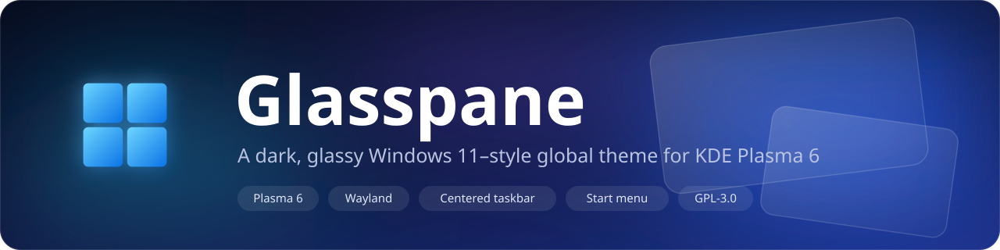
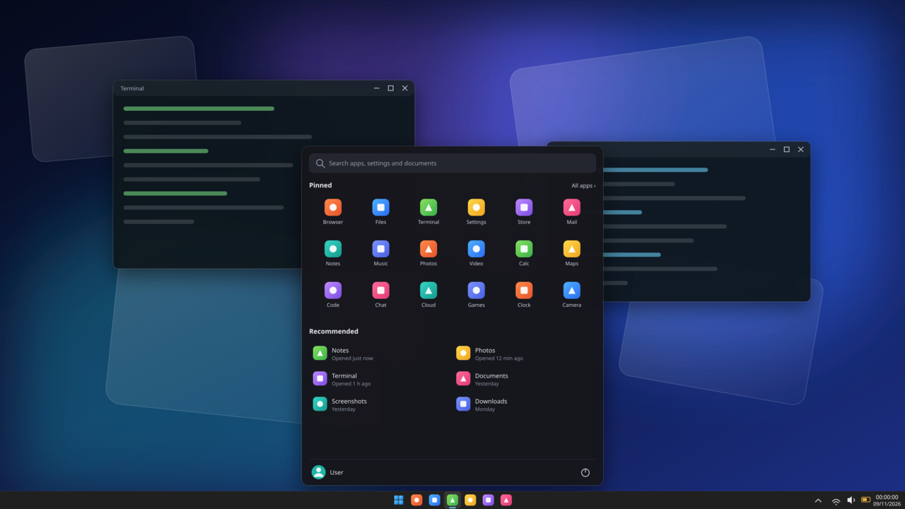

<p align="center">
  
</p>

<p align="center">
  
</p>

**Glasspane** is a dark, light-weight, Windows 11–style global theme for **KDE Plasma 6**. It restyles the whole
desktop and ships its own start menu, so the result feels like Windows 11 while staying a normal Plasma session.

## Features

- **Centered taskbar** with compact, square buttons and tight spacing – or a classic left-aligned one (see [Variants](#variants)).
- **Glasspane Start**, a custom start menu widget: search, pinned grid, recommended items, all-apps list, user and power menu.
  It floats above the taskbar with a gap and fully rounded corners, centered on the screen, and slides in from the bottom.
- **Windows-style system tray**: network, volume and battery in view, everything else behind the `^` arrow.
- **Windows-style clock**: time with seconds (`HH:mm:ss`) and the date (`dd/MM/yyyy`) underneath.
- Dark, translucent, rounded Plasma style, window decoration (Aurorae), widget style (Kvantum), colour scheme and cursors.
- One panel per screen, set up automatically.

## Requirements

- KDE Plasma 6 (developed and tested on Plasma 6.8, Fedora 44, Wayland).
- [Kvantum](https://github.com/tsujan/Kvantum) for the widget style
  (`sudo dnf install kvantum` · `sudo apt install qt6-style-kvantum`).
- `git` – only to fetch the Win11 icon theme on first install.

## Install

### Option A – one command (recommended)

```bash
git clone https://github.com/Joansitoh/glasspane-theme.git
cd glasspane-theme
./install.sh                 # centered taskbar (Windows 11 style)
./install.sh --layout=left   # taskbar on the left
./install.sh --no-apply      # install only, choose the theme in System Settings later
```

This installs every component into `~/.local/share` and `~/.config` and applies the theme.
No `sudo` required.

### Option B – from the KDE UI

1. Build the archives (or take them from a release): `./build.sh` → `dist/glasspane.tar.gz`
   and `dist/glasspane-left.tar.gz`.
2. **System Settings → Appearance → Global Theme → Get New… → Install from File…**, pick the archive.
3. Select **Glasspane** in the list, tick **Use desktop layout from theme**, and click **Apply**.

> **What a UI install can and cannot do.** KDE global-theme packages can only carry the colour scheme,
> the panel layout, the preview and the splash screen. The Plasma style, window decoration, Kvantum theme,
> cursors and the *Glasspane Start* widget live in other places, so they are **not** part of the archive.
> Without them the colours and layout apply, but the rest falls back to defaults (and the panel uses the
> stock Kickoff launcher instead of Glasspane Start). Run `./install.sh --no-apply` once to add the missing
> components, then select the theme from the UI.

## Variants

| Global theme | Taskbar |
|---|---|
| **Glasspane** | Centered like Windows 11. The start button sits with the app icons and its menu opens centered on the screen. |
| **Glasspane Left** | Classic. Start button on the left, app icons next to it, menu opens on the left. |

Switch any time from **System Settings → Appearance → Global Theme** (tick *Use desktop layout from theme*),
or from a terminal:

```bash
plasma-apply-lookandfeel -a com.joansitoh.Glasspane      --resetLayout   # centered
plasma-apply-lookandfeel -a com.joansitoh.Glasspane-Left --resetLayout   # left
```

> Applying a theme with its layout **rebuilds the panels**. Manual panel changes are replaced.

## Using the start menu

| Action | How |
|---|---|
| Open / close | Click the start button, press the **Meta** key, or **Esc** to close |
| Search | Just start typing; **Enter** launches the first result |
| All apps | **All apps ›** at the top right of the pinned section |
| Pin / unpin | Right-click an app |
| Power | Button at the bottom right: lock, log out, sleep, restart, shut down |

## Repository layout

`src/` mirrors where files end up on your system, so installing is a plain copy.

```
glasspane-theme/
├── install.sh · uninstall.sh · build.sh
├── assets/                          banner, preview and wallpaper (SVG sources + preview.png)
├── po/                              translations of the start menu (es.po; add more as <lang>.po)
├── scripts/
│   ├── package.sh                   assembles the global-theme packages (centered / left)
│   ├── build-mo.py                  compiles po/*.po into the widget (no gettext needed)
│   └── make-art.py                  regenerates the artwork, previews and splash
└── src/
    ├── share/                       → ~/.local/share
    │   ├── plasma/look-and-feel/com.joansitoh.Glasspane/   global theme: defaults, layout, previews, splash
    │   ├── plasma/desktoptheme/Glasspane/                  Plasma style (panel, dialogs, tooltips, taskbar buttons)
    │   ├── plasma/plasmoids/com.joansitoh.glasspane.start/ the start menu widget (QML)
    │   ├── color-schemes/Glasspane.colors
    │   ├── aurorae/themes/Glasspane/                       window decoration
    │   └── icons/                                          start button icon, Win10OS cursors
    ├── config/Kvantum/Glasspane/    → ~/.config/Kvantum     widget style
    └── variants/left/               layout script for Glasspane Left
```

## Customize

- **Panel layout** (height, widgets, spacing, clock format, tray items):
  `src/share/plasma/look-and-feel/com.joansitoh.Glasspane/contents/layouts/org.kde.plasma.desktop-layout.js`
  (and `src/variants/left/` for the left variant). Re-run `./install.sh` after editing.
- **Start menu**: `src/share/plasma/plasmoids/com.joansitoh.glasspane.start/contents/ui/` (`StartMenu.qml`, `main.qml`).
- **Translations**: the widget is written in English; copy `po/es.po` to `po/<lang>.po` and translate it.
- **Artwork**: edit `scripts/make-art.py` and run `python3 scripts/make-art.py` (needs ImageMagick with RSVG).

## Uninstall

```bash
./uninstall.sh
```

Removes everything the installer added except the cursors, the Win11 icon theme and your Kvantum selection.
Pick another global theme first.

## Troubleshooting

- **Restart the shell** if panels look stale: `kquitapp6 plasmashell; setsid -f plasmashell`.
- **Widget style looks plain** – Kvantum is missing or the `Glasspane` theme is not selected in `kvantummanager`.
- **Odd tray icons** – app icons (Synergy, Cloudflare WARP, …) are drawn by the apps themselves at low resolution.
  Hide them behind the `^` arrow: right-click the tray → *Configure System Tray…* → *Entries*.
- **Battery percentage** – enable *Show percentage* in the battery widget's settings (the layout script cannot reach it).

## Known limitations

- The tray's `^` arrow sits on the right of the icons; Plasma has no option to move it to the left.
- The start menu slide animation relies on KWin's *Sliding Popups* effect.
- Developed on a desktop machine with two monitors; laptop-specific bits (battery) are untested.

## Credits & license

Glasspane is released under the **GPL-3.0** (see [`LICENSE`](LICENSE)).

It builds on the work of others:

- [Win11OS-kde](https://github.com/yeyushengfan258/Win11OS-kde) by yeyushengfan258 (GPL-3.0) – Plasma style, window decoration, colour scheme, cursors.
- Kvantum theme by Vince Liuice, based on KvAdapta by Tsu Jan.
- [Win11 icon theme](https://github.com/yeyushengfan258/Win11-icon-theme) by yeyushengfan258 – fetched at install time, not bundled.
- Splash screen code adapted from KDE's Breeze splash by Marco Martin.
